  <a href="https://data-enricher.com/en">
    <picture>
      <source media="(prefers-color-scheme: dark)" srcset="assets/header-dark.svg">
      
    </picture>
  </a>

Data Enricher turns a single barcode into a complete product page. It finds the product online, writes the texts in 18 languages and picks photos that really show that exact product. It works right inside your webshop, or through the API.

<picture>
  <source media="(prefers-color-scheme: dark)" srcset="assets/stats-dark.svg">
  
</picture>

### How it works

<picture>
  <source media="(prefers-color-scheme: dark)" srcset="assets/pipeline-dark.svg">
  
</picture>

### What you get

<picture>
  <source media="(prefers-color-scheme: dark)" srcset="assets/features-dark.svg">
  
</picture>

### Works where you already work

<picture>
  <source media="(prefers-color-scheme: dark)" srcset="assets/platforms-dark.svg">
  
</picture>

- Only facts that can be found online. Store names, prices and contact details are filtered out.
- Photos are held against the product: same brand, same model, same version.
- Anything looked up before comes straight from the cache, and those requests are free.

  

  <a href="https://data-enricher.com/en">data-enricher.com</a> &nbsp;·&nbsp;
  <a href="https://data-enricher.com/en/demo">Live demo</a> &nbsp;·&nbsp;
  <a href="https://data-enricher.com/en/pricing">Pricing</a> &nbsp;·&nbsp;
  <a href="https://data-enricher.com/en/api-docs">API docs</a> &nbsp;·&nbsp;
  <a href="https://data-enricher.com/en/contact">Contact</a> &nbsp;·&nbsp;
  <a href="https://mark-app.com/en/">by MARK-APP</a>

